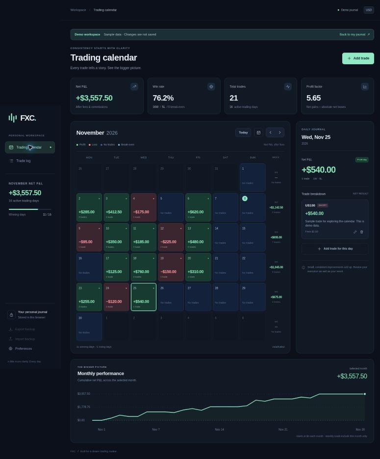

# FXC — Trading Calendar

A responsive, English-language trading journal for recording closed trades and reviewing daily profit and loss. Built with native JavaScript modules, HTML, and CSS. No runtime dependencies, API keys, broker connection, or paid services are required.



## Features

- Monthly calendar: **green** for profitable days, **red** for losing days, and **navy** for days without trades. Break-even trading days use a separate slate color.
- Daily net P&L and trade counts, with weekly totals for the displayed month.
- Add, edit, and delete trades, with a date, instrument, long/short direction, gross P&L, fees, and notes.
- Multiple trades per day are combined. **Net P&L = gross P&L − fees.** Enter fees as a positive amount; if your broker's P&L already includes fees, leave fees at zero.
- Monthly net P&L, trade win rate, active trading days, profit factor, and cumulative monthly performance chart.
- Searchable trade history with pagination and CSV export.
- JSON backups with validated merge or explicit full restore. Re-importing identical records does not duplicate them.
- Separate, temporary demo workspace. Your journal starts empty; demo trades never enter your personal journal automatically.
- Responsive desktop and mobile layouts, keyboard calendar navigation, and accessible native dialogs.
- Default journal timezone: **Asia/Kabul**. Preferences can change how Today and new trade dates are determined. Existing dates remain as entered.

## Run locally

Requires Node.js 22 or later. There are no dependencies to install.

```sh
npm run dev
```

Open `http://localhost:3000`. Set `PORT` if another port is needed. ES modules require an HTTP server; do not open `index.html` directly using a `file://` URL.

## Verify and build

```sh
npm test
npm run check
npm run build
```

The production build is written to `dist/`. Upload that directory to any static web host. Asset URLs are relative, so the build also supports a subdirectory such as `/fxc/`.

### Vercel

Import this repository into Vercel. The included `vercel.json` sets the build command to `npm run build` and the output directory to `dist`. No environment variables or database setup are needed.

### GitHub Pages

Build the project, then publish the contents of `dist/` using your preferred Pages deployment workflow. This repository does not automatically enable Pages or publish your journal.

## Data and calculation details

All amounts are entered and displayed in **USD**. Money is stored as integer cents to avoid decimal rounding errors. Daily colors and all statistics use net results after fees. Win rate is winning trades divided by all trades, including break-even trades. Profit factor is the sum of positive net results divided by the absolute sum of negative net results; it displays `∞` when gains exist without losses and `—` when neither exists. Weekly totals exclude dates outside the selected month. The performance chart begins at zero each month and is cumulative P&L, not an account balance or a compounded return.

Instrument names are labels, not contract specifications. For example, MNQ and US100 are distinct instruments; this app records the realized USD result you enter and does not assume their tick values are the same or calculate position sizing.

## Backups and privacy

Records are stored in `localStorage` under `fxc.journal.v1`, on this browser and this website origin only. They do not sync between devices, browsers, localhost, or different deployment domains. Export a JSON backup before changing hosts or clearing browser data. CSV is intended for viewing trade history; JSON is the supported restore format.

There is no sign-in or server database. Anyone who can use your browser profile can access your journal. Private browsing, blocked storage, storage limits, or clearing site data can prevent persistence. Failed writes are surfaced to the user and do not apply the change. Unreadable saved data is preserved and can be downloaded as a recovery file before restoring a valid backup.

Backups support up to 10,000 trades, notes of up to 2,000 characters, and trade dates from 1900 through 2100. Exported files contain your trade notes and results; keep them private. Import validates the entire file before applying any changes. A conflicting trade ID requires an explicit replacement rather than silently overwriting an edited trade.

## Source layout

- `src/domain.js` — dates, exact money parsing, aggregation, validation, and sample data.
- `src/storage.js` — persistence and safe backup merging.
- `src/app.js` — UI, journal actions, downloads, and calendar interactions.
- `tests/journal.test.js` — calculation, calendar, backup, and persistence checks.
- `scripts/` — dependency-free preview and build scripts.

All processing happens in the browser. No trading recommendations, market data, automated trades, or economic news are provided.
